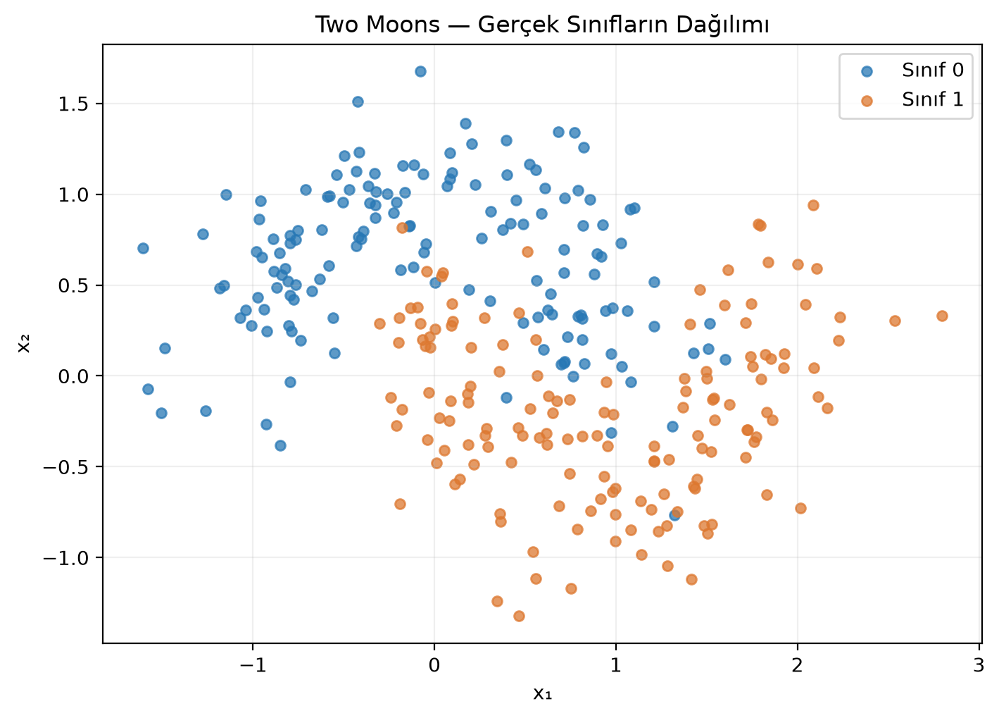
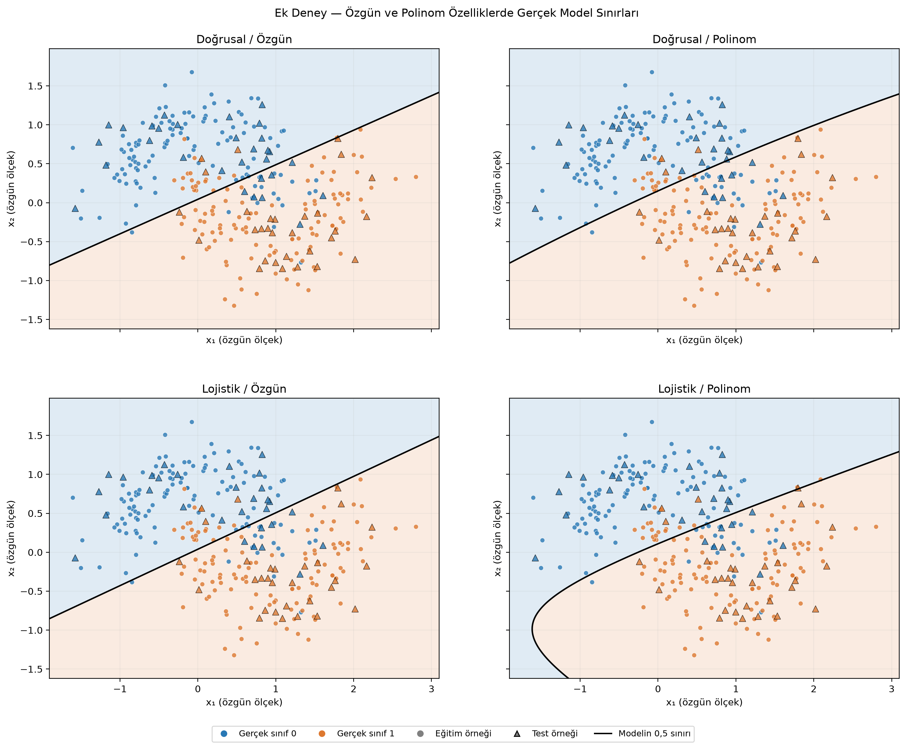
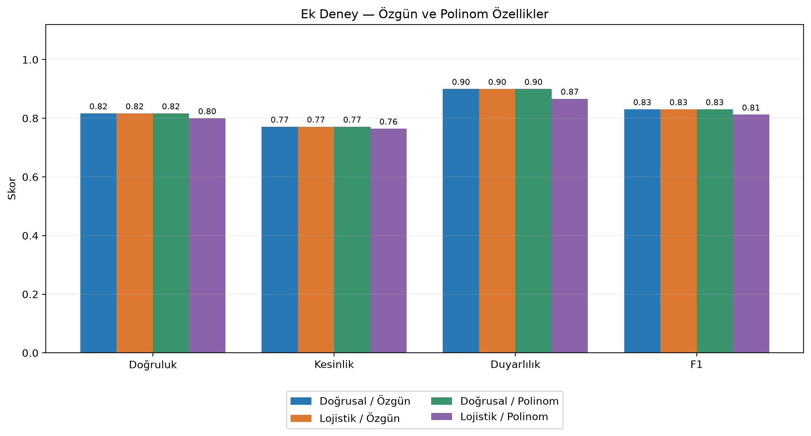

# Two Moons · Sıfırdan Regresyon Karşılaştırması

**NumPy ile doğrusal ve lojistik regresyon: aynı veri, aynı test kümesi, farklı kayıp fonksiyonları.**


Makine Öğrenimine Giriş · Bilgisayar Mühendisliği Lisans Projesi  
**Ondokuz Mayıs Üniversitesi (OMÜ)** · Mühendislik Fakültesi · Bilgisayar Mühendisliği

[Kurulum](#kurulum-ve-çalıştırma) · [Sonuçlar](#son-test-sonuçları) · [Görseller](#görseller) · [Testler](#testler-ve-doğrulama) · [Akademik rapor](Makine_Ogrenmesi_Proje_Raporu_OMU_Habib_Sultani.pdf)

## Proje hakkında

Bu projede, doğrusal olmayan **Two Moons** veri kümesi üzerinde doğrusal regresyon ve lojistik regresyon algoritmaları, hazır makine öğrenmesi modelleri kullanılmadan **NumPy ile sıfırdan** geliştirilmiş ve karşılaştırılmıştır.

> **Araştırma sorusu:** Farklı kayıp fonksiyonlarıyla eğitilen doğrusal regresyon ve lojistik regresyon, doğrusal olarak ayrılamayan iki sınıflı bir veri kümesinde nasıl sonuçlar üretir?

Her iki model aynı eğitim/test bölmelerinde değerlendirilmiştir. Temel karşılaştırmaya ek olarak, ikinci derece polinom özellik dönüşümünün karar sınırları ve sınıflandırma performansı üzerindeki etkisi incelenmiştir.

## Öne çıkan özellikler

- **Sıfırdan uygulama:** Model denklemleri, kayıp fonksiyonları, analitik gradyanlar ve Batch Gradient Descent NumPy ile yazılmıştır.
- **Adil karşılaştırma:** Dört model yapılandırması, aynı 60 test gözleminde ve aynı `0.5` sınıflandırma eşiğiyle değerlendirilmiştir.
- **Veri sızıntısına karşı önlem:** Ölçekleme parametreleri yalnızca ilgili eğitim kümesinden öğrenilir; hiperparametreler doğrulama verisiyle seçilir.
- **İncelenebilir çıktılar:** Kayıp eğrileri, karmaşıklık matrisleri, metrik tabloları ve gerçek model karar sınırları üretilir.
- **Doğrulama:** 22 otomatik birim testi ve kaydedilen sonuçları bağımsız olarak kontrol eden bir doğrulama betiği bulunur.

## Veri kümesi

| Özellik | Değer |
| --- | --- |
| Veri kümesi | Two Moons |
| Toplam gözlem | 300 |
| Giriş özellikleri | `x1`, `x2` |
| Hedef değişken | `label` |
| Sınıflar | `0` ve `1` |
| Sınıf dağılımı | 150 / 150 |
| Eksik değer | 0 |
| Yinelenen satır | 0 |
| Dosya | [data/two_moons.csv](data/two_moons.csv) |

İki sınıf iç içe geçen kavisli bölgeler oluşturur. Eğitim örneklerinin tek bir doğrusal karar sınırıyla kusursuz ayrılamadığı ayrıca geometrik olarak incelenmiştir. Kullanılan CSV'nin özgün üretim ayarları ve indirme kaynağı doğrulanamadığı için bunlar hakkında varsayım yapılmamaktadır.

## Kullanılan teknolojiler

| Teknoloji | Kullanım amacı |
| --- | --- |
| Python 3.13 | Önerilen Python sürümü |
| NumPy | Matris işlemleri, modeller, gradyanlar ve metrikler |
| Pandas | Veri okuma ve sonuç tabloları |
| Matplotlib | Grafikler ve karar sınırları |
| `unittest` | Otomatik testler; Python standart kütüphanesi |

**Ödev kuralı:** `sklearn.linear_model.LinearRegression`, `sklearn.linear_model.LogisticRegression` ve hazır optimizasyon algoritmaları kullanılmamıştır. Polinom özellikler de manuel oluşturulmuştur. Bağımlılıklar [requirements.txt](requirements.txt) dosyasındadır.

## Kurulum ve çalıştırma

Aşağıdaki komutları proje kökünde **PowerShell** ile çalıştırın.

### 1. Sanal ortamı hazırlayın

```powershell
py -3.13 -m venv .venv
.\.venv\Scripts\Activate.ps1
python -m pip install -r requirements.txt
```

<details>
<summary>PowerShell sanal ortamı etkinleştirmeyi engelliyorsa</summary>

Yalnızca geçerli terminal oturumu için aşağıdaki komutları kullanabilirsiniz:

```powershell
Set-ExecutionPolicy -Scope Process -ExecutionPolicy RemoteSigned
.\.venv\Scripts\Activate.ps1
```

Alternatif olarak, ortamı etkinleştirmeden komutlardaki `python` yerine `.\.venv\Scripts\python.exe` kullanabilirsiniz.

</details>

### 2. Testleri çalıştırın

```powershell
python -m unittest discover -s tests -v
```

### 3. Modelleri eğitin ve çıktıları doğrulayın

```powershell
python main.py
python verify_results.py
```

`main.py` deneyleri çalıştırır ve çıktıları `results/` klasörüne kaydeder. Aynı adlı sonuç dosyaları güncellenebilir; veri kümesi değiştirilmez. `verify_results.py`, eğitimden sonra kaydedilen parametreleri, tahminleri, metrikleri ve grafikleri kontrol eder.

## Proje yapısı

```text
.
├── data/
│   └── two_moons.csv             # Kullanılan veri kümesi
├── models/                       # Sıfırdan doğrusal ve lojistik regresyon
├── utils/                        # Ön işleme, metrikler, grafikler ve kontroller
├── tests/                        # 22 otomatik birim testi
├── results/
│   ├── graphs/                   # 12 PNG grafik
│   ├── metrics.csv               # Son test karşılaştırması
│   ├── test_predictions.csv      # Test gözlemleri ve tahminler
│   └── ...                       # Parametre, kayıp, bölme ve karar ızgarası kayıtları
├── main.py                       # Uçtan uca deney akışı
├── verify_results.py             # Kayıtlı sonuçların bağımsız kontrolü
├── requirements.txt              # Python bağımlılıkları
├── README.md
└── Makine_Ogrenmesi_Proje_Raporu_OMU_Habib_Sultani.pdf
```

## Deney tasarımı

| Aşama | Gözlem sayısı | Kullanım |
| --- | ---: | --- |
| Dış eğitim | 240 | Son modellerin eğitimi |
| ↳ İç eğitim | 192 | Hiperparametre adaylarının eğitimi |
| ↳ Doğrulama | 48 | Hiperparametre seçimi |
| Son test | 60 | Yalnızca nihai değerlendirme |

İç eğitim ve doğrulama kümeleri, 240 gözlemli dış eğitim kümesinin alt bölmeleridir.

| Ayar | Değer |
| --- | --- |
| Bölme yöntemi | Tabakalı (stratified), tohum değeri `42` |
| Standardizasyon | Eğitim ortalaması ve standart sapmasıyla `(X - mean) / std` |
| Öğrenme oranı adayları | `0.01`, `0.05`, `0.1` |
| Epoch adayları | `1000`, `3000`, `6000` |
| Seçim ölçütü | Doğrulama kümesinde sınıf 1 F1 skoru |
| Eşitlik kuralı | Daha yüksek doğruluk, daha az epoch, daha küçük öğrenme oranı |
| Sınıflandırma eşiği | `0.5` |

Her yapılandırma için 9, toplamda **36 hiperparametre adayı** değerlendirilir. Seçim tamamlandıktan sonra her model 240 dış eğitim gözlemiyle yeniden eğitilir ve aynı 60 test örneğinde değerlendirilir.

## Yöntemler

### Doğrusal regresyon

Model ve kayıp fonksiyonu:

$$
\hat{y} = X\theta + b, \qquad J(\theta, b) = \frac{1}{2m}\sum_{i=1}^{m}(\hat{y}^{(i)} - y^{(i)})^2
$$

Analitik gradyanlar:

$$
\nabla_{\theta}J = \frac{X^T(\hat{y} - y)}{m}, \qquad \frac{\partial J}{\partial b} = \operatorname{mean}(\hat{y} - y)
$$

Ham tahminler `0.5` eşiğiyle sınıfa dönüştürülür. Doğrusal regresyon çıktısı olasılık değildir ve `[0, 1]` aralığının dışında olabilir.

### Lojistik regresyon

Doğrusal skor sigmoid fonksiyonuyla olasılığa dönüştürülür:

$$
z = X\theta + b, \qquad p = \frac{1}{1 + e^{-z}}
$$

Amaç fonksiyonu **Binary Cross-Entropy (BCE)**'dir. Uygulamada sayısal kararlılık için eşdeğer `logaddexp` ifadesi kullanılır.

$$
\nabla_{\theta}J = \frac{X^T(p - y)}{m}, \qquad \frac{\partial J}{\partial b} = \operatorname{mean}(p - y)
$$

Her iki modelde de parametreler Batch Gradient Descent ile güncellenir:

$$
\theta \leftarrow \theta - \alpha\nabla_{\theta}J, \qquad b \leftarrow b - \alpha\frac{\partial J}{\partial b}
$$

Burada $\alpha$ öğrenme oranıdır. Lojistik regresyonda sigmoid kullanılması, özgün iki özellik üzerinde karar sınırının eğrisel olduğu anlamına gelmez; $p = 0.5$ sınırı hâlâ doğrusaldır.

### Polinom özellik deneyi

Özgün iki özellik elle beş özelliğe genişletilir:

$$
\phi(x_1, x_2) = [x_1,\ x_2,\ x_1^2,\ x_1x_2,\ x_2^2]
$$

Bu dönüşüm, özgün giriş uzayında eğrisel karar sınırlarını temsil etmeye olanak verir. Aynı iki algoritma bu yeni özelliklerle tekrar eğitilir.

## Son test sonuçları

Bütün değerler **60 ortak test örneğinde** hesaplanmıştır. Pozitif sınıf **1** olarak tanımlanmıştır. Ayrıntılı kayıt: [results/metrics.csv](results/metrics.csv).

| Model / Özellikler | Accuracy | Precision | Recall | F1-score | Specificity |
| --- | ---: | ---: | ---: | ---: | ---: |
| Doğrusal / Özgün | 81.67% | 77.14% | 90.00% | 0.8308 | 73.33% |
| Lojistik / Özgün | 81.67% | 77.14% | 90.00% | 0.8308 | 73.33% |
| Doğrusal / Polinom | 81.67% | 77.14% | 90.00% | 0.8308 | 73.33% |
| Lojistik / Polinom | 80.00% | 76.47% | 86.67% | 0.8125 | 73.33% |
| Çoğunluk referansı¹ | 50.00% | 0.00% | 0.00% | 0.0000 | 100.00% |

¹ Veri kümesi dengeli olduğundan çoğunluk referansında eşitlik oluşur; uygulamanın eşitlik kuralı sınıf `0` seçmektir.

**Temel bulgular:**

- Özgün özelliklerde iki model de **49 doğru / 11 yanlış** tahminle **%81.67 doğruluk** elde etmiştir.
- Kayıp fonksiyonları ve ham çıktılar farklı olsa da iki özgün modelin son sınıf tahminleri bu deneyde aynıdır.
- İkinci derece polinom özellikler test doğruluğunu artırmamıştır; polinom lojistik regresyon **%80.00** doğruluk elde etmiştir.
- Bu bulgular tek bir test bölmesine aittir; algoritmalardan birinin her koşulda üstün olduğu sonucu çıkarılamaz.

### Özgün modellerin karmaşıklık matrisi

Her iki özgün model için:

| Gerçek / Tahmin | Sınıf 0 | Sınıf 1 |
| --- | ---: | ---: |
| Sınıf 0 | TN = 22 | FP = 8 |
| Sınıf 1 | FN = 3 | TP = 27 |

Sınıf 1 için duyarlılık `27 / 30 = %90`; doğruluk `(22 + 27) / 60 = %81.67` olarak hesaplanır.

## Görseller

### Veri dağılımı



### Özgün ve polinom özelliklerle karar sınırları



### Test metriklerinin karşılaştırılması



Kayıp eğrileri ve karmaşıklık matrisleri dahil tüm görseller [results/graphs/](results/graphs/) klasöründedir.

## Üretilen çıktılar

| Çıktı | İçerik |
| --- | --- |
| [metrics.csv](results/metrics.csv) | Modellerin son test metrikleri |
| [test_predictions.csv](results/test_predictions.csv) | Gerçek etiketler, ham çıktılar ve sınıf tahminleri |
| [selected_hyperparameters.json](results/selected_hyperparameters.json) | Doğrulama kümesiyle seçilen ayarlar |
| [validation_results.csv](results/validation_results.csv) | 36 hiperparametre adayının sonuçları |
| [split_indices.csv](results/split_indices.csv) | İç eğitim, doğrulama ve test satırları |
| [model_parameters.npz](results/model_parameters.npz) | Öğrenilen parametreler, ölçekler ve bölme indeksleri |
| [decision_grid.npz](results/decision_grid.npz) | Karar sınırlarını oluşturan ızgara ve model skorları |
| [runtime_versions.json](results/runtime_versions.json) | Çıktıların üretildiği Python ve kütüphane sürümleri |
| [graphs/](results/graphs/) | 200 dpi olarak kaydedilen 12 PNG grafik |

Ek parametre tabloları, kayıp geçmişleri ve veri kümesi bilgileri de `results/` altında saklanır. CSV dosyalarının çoğu UTF-8 BOM biçimindedir; kayıp geçmişleri varsayılan UTF-8 biçiminde yazılır.

## Testler ve doğrulama

```powershell
python -m unittest discover -s tests -v
python verify_results.py
```

**22 birim testi**; regresyon tahminlerini, MSE/BCE kayıplarını, sigmoidin sayısal kararlılığını, analitik gradyanların sonlu farklarla kontrolünü, veri bölmelerini, standardizasyonu, polinom dönüşümünü ve sınıflandırma metriklerini kapsar.

Bağımsız doğrulama betiği; veri dosyasının SHA-256 değerini, bölmelerin ayrıklığını, hiperparametre seçim kuralını, kaydedilen parametrelerden yeniden hesaplanan test tahminlerini ve karar ızgarasını kontrol eder. Ayrıca metrikleri bağımsız olarak hesaplar ve 12 PNG dosyasının okunabilir ve boş olmadığını doğrular.

## Akademik rapor

[**Proje raporunu görüntüle (PDF)**](Makine_Ogrenmesi_Proje_Raporu_OMU_Habib_Sultani.pdf)

Rapor; veri kümesini, yöntemleri, matematiksel temelleri, eğitim düzenini, görselleştirmeleri, karşılaştırmalı sonuçları, tartışmayı ve kaynakçayı içerir.

## Sınırlılıklar

- Deney, 300 gözlemli tek bir veri kümesine ve tek bir dış test bölmesine dayanmaktadır.
- Modellerin aynı doğruluğu elde etmesi, matematiksel olarak aynı algoritma oldukları anlamına gelmez.
- Polinom dönüşümü daha esnek bir temsil sunar ancak daha yüksek test başarısı garanti etmez.
- Bazı eğitim kayıpları seçilen epoch sonunda düşmeye devam eder; bütün yapılandırmalarda tam yakınsama iddia edilmez.
- CSV'nin özgün üretim ayarları doğrulanamadığından veri kökeni hakkında ek iddia yapılmaz.

## Hazırlayan

**Habib Sultani** · Öğrenci No: `22061001`  
Ondokuz Mayıs Üniversitesi · Bilgisayar Mühendisliği  
Ders: Makine Öğrenimine Giriş

---

**Konu etiketleri:** `machine-learning` · `two-moons` · `linear-regression` · `logistic-regression` · `gradient-descent` · `numpy` · `classification` · `from-scratch`
